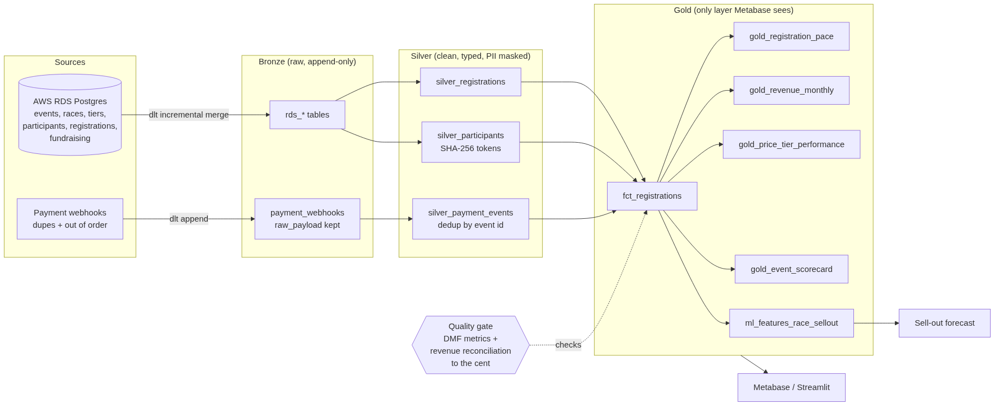
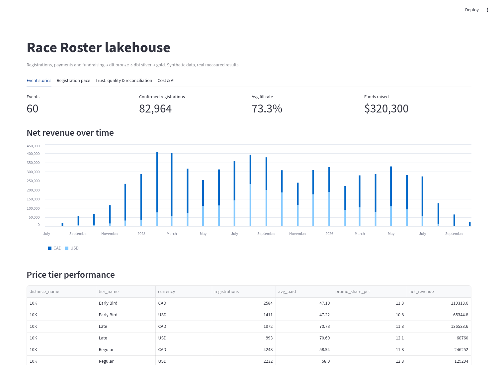
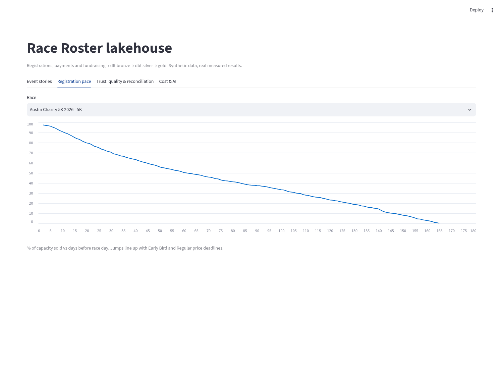
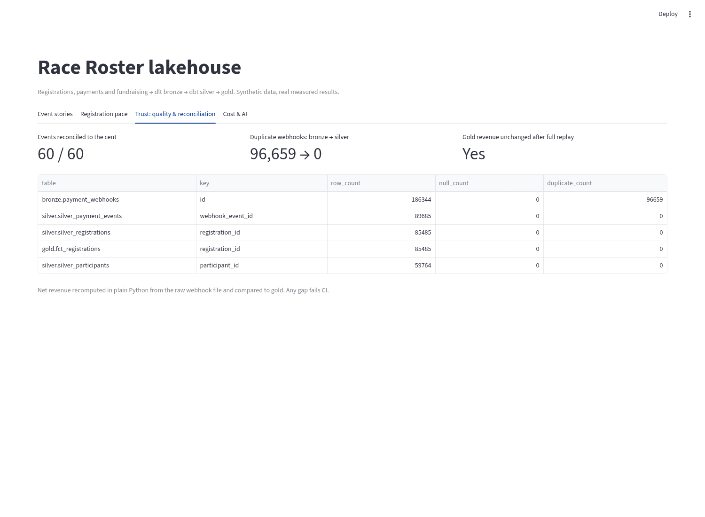
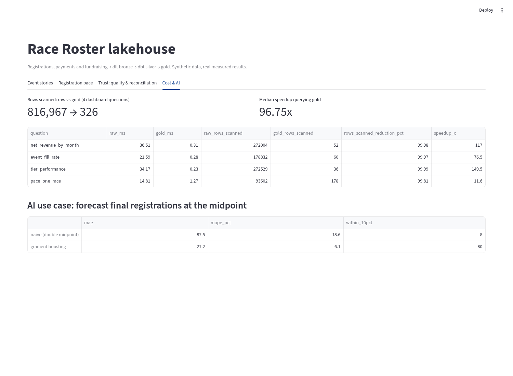

# race-registration-lakehouse

A working first version of a greenfield data platform for an endurance event company like **Race Roster**: registrations, price tiers, payments, refunds and fundraising flow from AWS RDS and payment webhooks into a **bronze → silver → gold** medallion layout, with PII masked, money reconciled to the cent, cost measured, and a gold feature table that feeds an AI forecast.

All data is synthetic (seeded, so every run gives the same numbers). Every result below comes from the actual run in `results/`.



## The problem

A race platform has a lot of money and people data, but it comes from messy places:

- **Registrations live in the app database** (AWS RDS). Organizers want to know: how fast is my race filling, which price tier sells, how much did I make this month, how much did my runners raise?
- **Payments arrive as webhooks.** Processors resend the same event, and events arrive out of order. If you sum them naively, revenue is wrong, and nobody trusts the dashboard again.
- **Participant data is personal** (email, phone, birth date). It must not leak into BI tools.
- **A new Snowflake account can get expensive fast** if dashboards hit raw tables.
- **AI work needs clean features**, not raw tables.

## How it maps to the Race Roster job post

| Job post asks for | Where it is in this repo |
|---|---|
| Python ELT with dlt from AWS RDS, APIs, webhooks, raw state kept for lineage | `src/ingest.py`: dlt incremental merge for RDS tables, append-only webhooks with the exact `raw_payload` kept, `_dlt_load_id` on every row |
| Bronze → silver → gold, only gold exposed to Metabase | `dbt/models/{bronze,silver,gold}`, plus the same flow as Snowflake Dynamic Tables in `snowflake/02_dynamic_tables.sql`, and grants so the BI role only sees gold |
| Participant growth, revenue over time, registration dynamics, pricing tiers, event performance | `gold_registration_pace`, `gold_revenue_monthly`, `gold_price_tier_performance`, `gold_event_scorecard` |
| FinOps from day 1: warehouse sizing, auto-suspend, query profiling | `snowflake/01_foundation.sql` (XS warehouses, 60s auto-suspend, resource monitor), `src/finops.py` (measured raw vs gold scans) |
| Snowflake Tasks, DMFs, lineage, Dynamic Data Masking | `snowflake/03_governance.sql`, `snowflake/04_tasks.sql`; local twins in `dbt/macros/masking.sql` and `src/quality.py` |
| PII, RBAC, retention, GDPR / CCPA | Masked SHA-256 tokens in silver, PII test in dbt and pytest, 400-day webhook purge task |
| AI / ML feature pipelines | `ml_features_race_sellout` + `src/forecast.py` |
| DuckDB, Parquet/Arrow, Streamlit | DuckDB is the local warehouse, sources are Parquet read through Arrow, `app.py` is the stakeholder app |
| Orchestration, and knowing when each fits | Airflow DAG in `dags/`, Snowflake Tasks in `snowflake/04_tasks.sql` |
| Terraform, Git, CI/CD, Docker | `terraform/main.tf`, GitHub Actions, `Dockerfile` |

## The data

Generated by `src/synth.py`, shaped like a real race platform:

| Source | Rows |
|---|---|
| Events (Canadian and US cities, CAD and USD) | 60 |
| Races (5K to 50K ultra, each with a capacity) | 175 |
| Price tiers (Early Bird, Regular, Late, each with dates) | 525 |
| Participants (30% chance a runner comes back for another race) | 59,764 |
| Registrations (bunch up near price deadlines and race day, 12% use a promo code) | 85,485 |
| Fundraising pages / donations | 441 / 4,112 |
| Payment webhooks (charges and refunds) | 93,172, of which 3,487 are duplicate deliveries, and about 10% shuffled out of order |

## Results (from the real run)

**Trust**
- Net revenue for **60 of 60 events matches to the cent**. The check recomputes revenue in plain Python straight from the raw webhook file and compares it to gold: 4,349,612.85 CAD plus 2,317,484.75 USD.
- Confirmed registrations: **82,964 in the source and 82,964 in gold**.
- Duplicate webhooks: **3,487 in bronze, 0 in silver**.
- **Replay test:** the full webhook history was loaded a second time (96,659 duplicate deliveries in bronze). Gold revenue did not change by a single cent.
- No raw email, phone, name or birth date reaches silver or gold.

**Cost (same 4 dashboard questions, raw bronze vs gold)**

| Question | Rows scanned (raw → gold) | Speedup |
|---|---|---|
| Net revenue by month | 272,004 → 52 | 196.7x |
| Event fill rate | 178,832 → 60 | 82.4x |
| Price tier performance | 272,529 → 36 | 67.9x |
| Pace for one race | 93,602 → 178 | 10.3x |
| **Total** | **816,967 → 326 (99.96% less)** | **75x median** |

On Snowflake, scanned data and warehouse time are what costs credits, so pointing Metabase only at gold is the main cost lever. Times are from a local laptop-class box and will vary.

**AI use case: forecast a race's final registrations at the halfway point of its sales window**

| Method | Mean abs. error | MAPE | Within 10% |
|---|---|---|---|
| Naive: double the midpoint count | 87.5 runners | 18.6% | 8.0% of races |
| Gradient boosting on gold features | 21.2 runners | 6.1% | 80.0% of races |

Tested with 5-fold cross validation, holding out whole events so the model never sees the event it predicts. This is the kind of signal that tells an organizer when to add capacity or push a promo.

**Run time:** the whole pipeline (generate, ingest, build, check, benchmark, forecast, replay) took 41.5 seconds locally.

## Screenshots

| Event stories | Registration pace |
|---|---|
|  |  |
| **Quality and reconciliation** | **Cost and AI** |
|  |  |

## How to run

```bash
pip install -r requirements.txt
python -m src.run_all      # about 45 seconds
pytest -q
streamlit run app.py
```

To load Snowflake instead of DuckDB, set `DESTINATION=snowflake` with dlt credentials, run `snowflake/*.sql` in order, and use the `snowflake` dbt target.

## Design choices

- **Bronze is append-only.** Duplicates stay in bronze on purpose, so you can always answer "what exactly did the processor send us?". Dedup happens once, in silver.
- **Masking in silver, not gold.** Masking early means no downstream model can leak PII by accident. Tokens are stable hashes, so distinct runner counts and joins still work.
- **Dynamic Tables + Tasks vs Airflow.** For a small team on one warehouse, Snowflake-native refresh means one less system to run. An external scheduler like Airflow makes sense once there are many non-Snowflake steps (APIs, ML training, reverse ETL). Both are here.
- **Money in integer cents.** Reconciliation compares cents, so floating-point rounding can't hide a gap.

## What I'd do next

- Snowpipe Streaming for webhooks instead of micro-batches.
- Currency conversion to one reporting currency with a daily FX table.
- A Metabase model on gold with organizer-level row access.
- Image pipeline for race photos (bib number detection with Amazon Rekognition) feeding a participant photo table.
